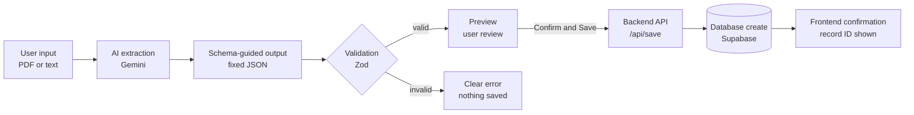
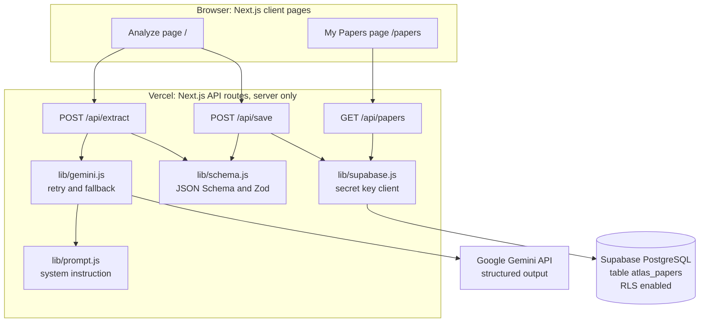
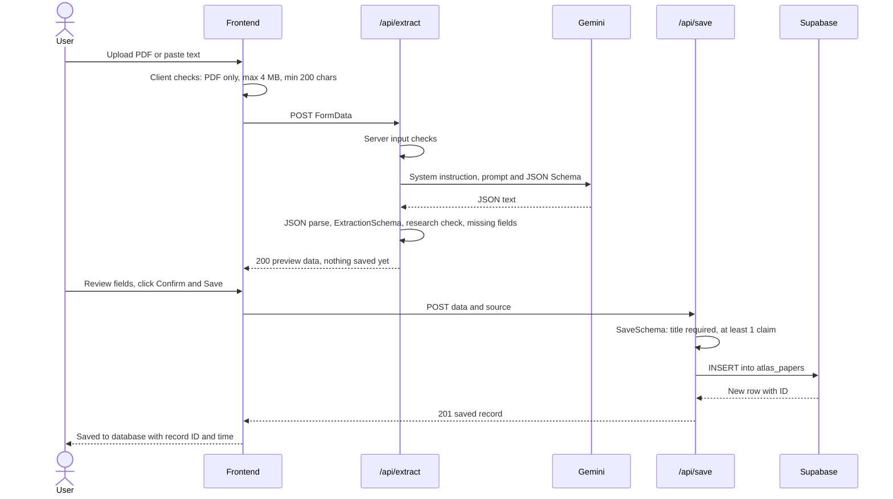
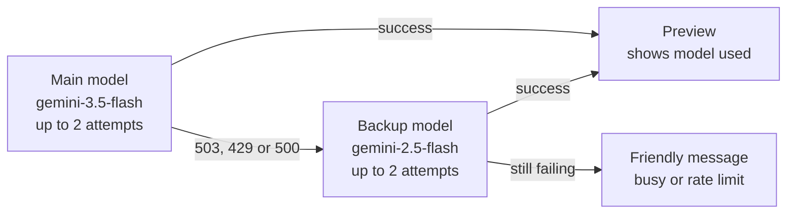
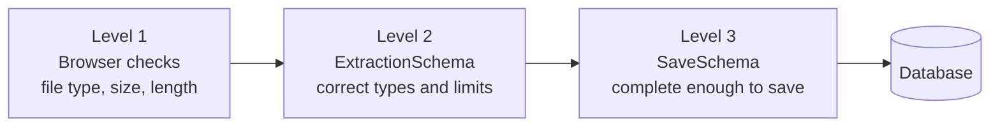
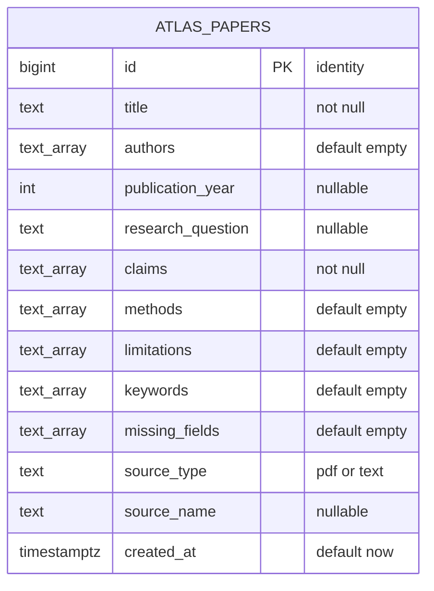
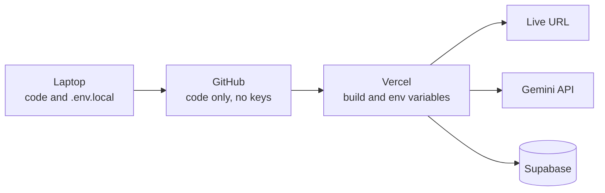

<div align="center">

# 🧭 AtlasForge

### AI Research & Knowledge Navigator

**Turn unstructured research papers into structured, validated, searchable knowledge using schema-guided Generative AI.**


**🔗 Live Demo:** https://YOUR-APP.vercel.app

*CSB312 Generative AI · CA3 Mini Project 2 · Option 5: AtlasForge*

</div>

---

## 📌 Table of Contents

1. [Problem Statement](#-problem-statement)
2. [Objective](#-objective)
3. [Selected Automation Idea](#-selected-automation-idea)
4. [Key Features](#-key-features)
5. [End-to-End Workflow](#-end-to-end-workflow)
6. [System Architecture](#-system-architecture)
7. [Request Lifecycle](#-request-lifecycle)
8. [Schema Design](#-schema-design)
9. [Prompt Design](#-prompt-design)
10. [Validation Strategy](#-validation-strategy)
11. [Error Handling](#-error-handling)
12. [Database Design](#-database-design)
13. [API Reference](#-api-reference)
14. [Security and Safeguards](#-security-and-safeguards)
15. [Tech Stack](#-tech-stack)
16. [Project Structure](#-project-structure)
17. [Run Locally](#-run-locally)
18. [Testing](#-testing)
19. [Deployment](#-deployment)
20. [Screenshots](#-screenshots)
21. [Limitations](#-limitations)
22. [Future Improvements](#-future-improvements)
23. [Conclusion](#-conclusion)

---

## ❓ Problem Statement

Students and researchers read many research papers, but the important information (claims, methods, limitations, keywords) stays buried inside long, unstructured PDFs. Manually extracting and organising this information is slow, inconsistent, and hard to search later. Simply asking a chatbot to "summarise" a paper produces free-form text that cannot be stored, validated, or queried reliably.

## 🎯 Objective

Build a full-stack Generative AI application that:

- accepts a research paper as a **PDF upload** or **pasted text**,
- uses **schema-guided prompting** so the AI returns data in a **fixed JSON structure**,
- **validates** that output and **never silently invents missing values**,
- lets the user **preview and confirm** the result, and
- **creates a database record** and confirms it on the frontend.

## 🧩 Selected Automation Idea

> **Option 5, Idea 1:** *Convert a research paper or uploaded document into structured claims, methods, limitations, and keywords.*

---

## ✨ Key Features

| Feature | Description |
|---|---|
| 📄 Two input types | Upload a PDF (up to 4 MB) or paste text (minimum 200 characters) |
| 🤖 Schema-guided AI | Gemini is constrained by a JSON Schema, so output always has the same shape |
| ✅ Two-level validation | Zod checks data types after extraction, and stricter rules before saving |
| 🚫 No hallucinated fields | Missing values are returned as `null` or `[]` and listed in `missing_fields` |
| 🔍 Non-research detection | Inputs like recipes or stories are rejected with a clear message |
| 👀 Human review | A preview screen shows every field; nothing is saved until **Confirm & Save** |
| 🗄️ Database create | Confirmed data is inserted into Supabase PostgreSQL |
| 📚 My Papers | A searchable list of all saved papers with expandable details |
| 🔁 Resilient AI calls | Automatic retry plus fallback model when Gemini is busy |
| 🔐 Secure by design | Secret keys stay on the server; Row Level Security blocks public access |

---

## 🔄 End-to-End Workflow

This follows the exact workflow required by the assignment brief.



---

## 🏗️ System Architecture

AtlasForge is a single Next.js application deployed on Vercel. The frontend pages and the backend API routes live in the same project, while Gemini and Supabase are external services that are only ever called from the server.



---

## ⏱️ Request Lifecycle

The extract step and the save step are **separate API calls**. This is what makes the preview and confirmation step possible.



### Retry and fallback for the AI call

External AI services can be temporarily overloaded. Instead of failing immediately, AtlasForge retries and then switches to a backup model.



---

## 🧬 Schema Design

The schema is the core of the project. **The same field definitions are used in two places**: as a JSON Schema sent to Gemini to force the output shape, and as Zod schemas on the server to validate that output.

| Field | Type | Rule |
|---|---|---|
| `is_research_paper` | boolean | `false` if the input is not academic content |
| `title` | string or null | Required to save (min 3 characters) |
| `authors` | string[] | Empty array if not found |
| `publication_year` | integer or null | Only if explicitly stated, 1900 to 2100 |
| `research_question` | string or null | Main question or objective |
| `claims` | string[] | Max 5; at least 1 required to save |
| `methods` | string[] | Max 5 |
| `limitations` | string[] | Max 5; only if stated by the authors |
| `keywords` | string[] | 3 to 8 lowercase keywords |
| `missing_fields` | string[] | Names of fields that could not be found |

### Sample structured AI output

Real output from a PDF upload (shortened). Note that `publication_year` is `null` and `limitations` is `[]` because they were not clearly present, and both are listed in `missing_fields` instead of being guessed.

```json
{
  "is_research_paper": true,
  "title": "OpenTac: An Open Ecosystem for Customizable, Scalable, and Transferable 3D Tactile Sensing",
  "authors": ["Ariel Slepyan", "Geeta Chandra Raju Bethala", "Jiafeng Gu", "..."],
  "publication_year": null,
  "research_question": "How can an open full-stack ecosystem enable customizable, scalable tactile skins for robotics?",
  "claims": [
    "OpenTac-CAD automatically generates sensor fabrication files from 2D outlines, 3D meshes, or text prompts.",
    "OpenTac-Xampling enables kilohertz-rate partial readouts, 19.2x faster than full raster scanning."
  ],
  "methods": [
    "Piezoresistive tactile skin with elastomeric bump overlays",
    "OpenTac-Sim built on MuJoCo"
  ],
  "limitations": [],
  "keywords": ["tactile sensing", "robotics", "sensor design"],
  "missing_fields": ["publication_year", "limitations"]
}
```

---

## 🗣️ Prompt Design

The prompt is split into a **system instruction** (fixed rules) and a **user prompt** (the document).

**System instruction rules (summary):**

1. Extract information **only** from the provided document.
2. Never invent, guess, or use outside knowledge; use `null` or `[]` when a value is absent.
3. List every field that could not be found in `missing_fields`.
4. If the input is not research content, set `is_research_paper` to `false`.
5. Field-specific rules: exact title, authors in order, year only if explicit, up to 5 short claims, methods, and limitations, 3 to 8 lowercase keywords.
6. Respond only with JSON matching the schema.

**Generation settings:** `responseMimeType: application/json`, `responseJsonSchema: EXTRACTION_JSON_SCHEMA`, `temperature: 0.1` (low randomness for consistent extraction).

---

## 🛡️ Validation Strategy

Validation happens at **three levels**, so bad data can never reach the database.



| Level | Where | What it checks |
|---|---|---|
| 1. Input checks | Browser and `/api/extract` | PDF only, max 4 MB, text at least 200 characters, not empty |
| 2. ExtractionSchema | `/api/extract` | AI output has the right types, array limits, valid year range |
| 3. SaveSchema | `/api/save` | Title present, at least one claim, valid source type. Runs again on the server because the browser could send edited data |

In addition, the server **re-checks missing fields itself** rather than trusting the AI alone, and merges the result with the AI's `missing_fields` list.

---

## 🚨 Error Handling

Every failure returns a clear JSON message (`{ ok: false, error, details? }`) and the frontend displays it in a red error box. Nothing is saved when an error occurs.

| Situation | Status | Message shown to user |
|---|---|---|
| No file and no text | 400 | Please upload a PDF or paste some text. |
| Not a PDF file | 400 | Only PDF files are supported. |
| PDF larger than 4 MB | 400 | PDF is too large. Maximum size is 4 MB. |
| Text under 200 characters | 400 | Text is too short. |
| Input is not a research paper | 422 | This does not look like a research paper. |
| AI output fails the schema | 422 | The AI output did not match the required schema. |
| Required fields missing on save | 422 | Cannot save: required information is missing or invalid. |
| Gemini rate limit | 429 | AI rate limit reached. Please wait a minute. |
| AI returned broken JSON | 502 | The AI returned invalid output. |
| Gemini overloaded after retries | 503 | The AI service is busy right now. |
| Database or config failure | 500 | Could not save to the database. |
| Network failure in browser | — | Could not reach the server. |

---

## 🗄️ Database Design

One table, `atlas_papers`, in Supabase PostgreSQL.



```sql
create table atlas_papers (
  id                bigint generated always as identity primary key,
  title             text not null,
  authors           text[] not null default '{}',
  publication_year  int,
  research_question text,
  claims            text[] not null,
  methods           text[] not null default '{}',
  limitations       text[] not null default '{}',
  keywords          text[] not null default '{}',
  missing_fields    text[] not null default '{}',
  source_type       text not null check (source_type in ('pdf', 'text')),
  source_name       text,
  created_at        timestamptz not null default now()
);

alter table atlas_papers enable row level security;
```

**Create operation:** after the user clicks **Confirm & Save**, `/api/save` builds a record using only allowed keys, validates it with `SaveSchema`, and runs `insert(...).select().single()`. The new row (with its generated `id` and `created_at`) is returned and displayed as *"Record #ID created at DATE TIME"*.

**Read operation:** `/api/papers` returns the latest 50 papers, newest first, with optional title search (`?q=`).

---

## 📡 API Reference

### `POST /api/extract`

Extracts structured data. **Does not save anything.**

**Request:** `multipart/form-data` with either `file` (PDF) or `text` (string).

**Success (200):**
```json
{
  "ok": true,
  "data": { "title": "...", "claims": ["..."], "missing_fields": ["limitations"] },
  "missing_required": [],
  "can_save": true,
  "model_used": "gemini-3.5-flash",
  "source": { "type": "pdf", "name": "paper.pdf" }
}
```

**Errors:** 400, 422, 429, 500, 502, 503.

### `POST /api/save`

Validates and inserts a confirmed record.

**Request:** `application/json`
```json
{ "data": { "title": "...", "claims": ["..."] }, "source": { "type": "pdf", "name": "paper.pdf" } }
```

**Success (201):**
```json
{ "ok": true, "message": "Saved successfully", "record": { "id": 2, "title": "...", "created_at": "..." } }
```

**Errors:** 400, 422 (with `details`), 500.

### `GET /api/papers?q=optional`

Returns saved papers. **Success (200):** `{ "ok": true, "count": 3, "papers": [ ... ] }`. **Error:** 500.

---

## 🔐 Security and Safeguards

- **Secret keys are server-only.** `GEMINI_API_KEY` and `SUPABASE_SERVICE_ROLE_KEY` are read only inside API routes and are never sent to the browser.
- **`.env.local` is git-ignored**, so keys are never pushed to GitHub. On Vercel they are stored as encrypted environment variables.
- **Row Level Security** is enabled on `atlas_papers` with no public policies, so the table cannot be accessed with public keys. Only the backend can read or write.
- **Human-in-the-loop:** a preview and explicit confirmation are required before any database write.
- **Server never trusts the client:** `/api/save` re-validates all data and ignores unexpected keys.
- **Input limits** (file type, 4 MB size, 60,000 character cap) protect the server and the AI quota.
- Errors are logged on the server without ever printing secrets.

---

## 🧰 Tech Stack

| Layer | Technology | Why |
|---|---|---|
| Frontend | Next.js 16 (App Router), React 19, Tailwind CSS 4 | Fast UI, one project for frontend and backend |
| Backend | Next.js Route Handlers | API endpoints deployed together with the frontend |
| AI | Google Gemini via `@google/genai` | Native structured output with JSON Schema, PDF input support, free tier |
| Validation | Zod | Clear, typed validation with readable error messages |
| Database | Supabase (PostgreSQL) | Managed Postgres with Row Level Security |
| Hosting | Vercel | One-click deployment from GitHub |

---

## 📁 Project Structure

```
atlasforge/
├── app/
│   ├── layout.js              # Header, navigation, footer
│   ├── page.js                # Analyze page: input, preview, confirm, saved
│   ├── papers/page.js         # My Papers page: list, search, details
│   └── api/
│       ├── extract/route.js   # POST: AI extraction + validation (no save)
│       ├── save/route.js      # POST: validate + insert into database
│       └── papers/route.js    # GET: list saved papers
├── components/
│   └── NavLinks.js            # Active navigation links
├── lib/
│   ├── schema.js              # JSON Schema + ExtractionSchema + SaveSchema
│   ├── prompt.js              # System instruction + user prompt builder
│   ├── gemini.js              # Gemini call with retry and fallback
│   └── supabase.js            # Server-only database client
├── scripts/
│   ├── test-db.mjs            # Database connection test
│   ├── test-schema.mjs        # Schema validation tests
│   ├── test-extract.mjs       # Extraction API tests
│   └── test-save.mjs          # Save and list API tests
└── .env.local                 # Secret keys (never committed)
```

---

## 💻 Run Locally

**Requirements:** Node.js 20.9 or higher, a Gemini API key, and a Supabase project.

```bash
git clone https://github.com/YOUR-USERNAME/atlasforge.git
cd atlasforge
npm install
```

Create `.env.local` in the project root:

```
GEMINI_API_KEY=your_gemini_key
SUPABASE_URL=https://your-project.supabase.co
SUPABASE_SERVICE_ROLE_KEY=your_supabase_secret_key
```

Run the SQL from the [Database Design](#-database-design) section in the Supabase SQL Editor, then:

```bash
npm run dev
```

Open http://localhost:3000

---

## 🧪 Testing

| Test | Command | Result |
|---|---|---|
| Database connection | `node --env-file=.env.local scripts/test-db.mjs` | ✅ DB connection OK |
| Schema validation | `node scripts/test-schema.mjs` | ✅ All schema tests passed |
| Extraction API | `node scripts/test-extract.mjs` | ✅ All extract tests passed |
| Save and list API | `node scripts/test-save.mjs` | ✅ All save tests passed |
| Production build | `npm run build` | ✅ Compiled successfully |

*(The extract and save tests need `npm run dev` running.)*

**Manual test cases:**

| # | Case | Input | Expected | Result |
|---|---|---|---|---|
| 1 | Successful flow | Real research paper PDF | Preview, then saved with record ID | ✅ Pass |
| 2 | Missing fields | PDF without explicit year or limitations | Shown as "Not found", listed in missing fields | ✅ Pass |
| 3 | Empty input | Nothing selected | 400 error message | ✅ Pass |
| 4 | Not a research paper | Recipe text | 422 error message | ✅ Pass |
| 5 | Wrong file type | `.jpg` file | Only PDF files supported | ✅ Pass |
| 6 | File too large | 9.7 MB PDF | PDF is too large | ✅ Pass |
| 7 | Incomplete save | Title null, no claims | 422 with field details | ✅ Pass |
| 8 | AI overloaded | Gemini 503 | Retry, fallback, friendly message | ✅ Pass |

---

## 🚀 Deployment



1. Push the code to GitHub (`.env.local` is ignored).
2. Import the repository on Vercel.
3. Add `GEMINI_API_KEY`, `SUPABASE_URL`, and `SUPABASE_SERVICE_ROLE_KEY` as environment variables.
4. Deploy. Every push to `main` redeploys automatically.

**Live URL:** https://YOUR-APP.vercel.app

---

## 🖼️ Screenshots

| Screen | Image |
|---|---|
| Analyze page | `docs/screenshots/01-home.png` |
| Preview with schema valid badge and missing fields | `docs/screenshots/02-preview.png` |
| Structured JSON output | `docs/screenshots/03-json.png` |
| Saved to database confirmation | `docs/screenshots/04-saved.png` |
| My Papers list | `docs/screenshots/05-my-papers.png` |
| Supabase table with saved rows | `docs/screenshots/06-supabase.png` |
| Error: not a research paper | `docs/screenshots/07-error-not-research.png` |
| Error: file too large | `docs/screenshots/08-error-too-large.png` |

---

## ⚠️ Limitations

- **4 MB PDF limit**, because Vercel serverless functions reject request bodies above about 4.5 MB.
- **Scanned (image-only) PDFs** may extract poorly compared to text-based PDFs.
- **AI output can vary slightly between runs** (for example, one run may find a limitation that another treats as absent). This is why human review before saving is required.
- **Free-tier limits:** Gemini free-tier rate limits apply, and Supabase free projects pause after 7 days of inactivity.
- Only the **create** and **read** operations are implemented; editing and deleting records are not available in the UI.
- Search is by **title only**.
- No user accounts: all saved papers are shared in one list.

## 🔭 Future Improvements

- Let users **edit fields in the preview** before saving.
- **Update and delete** records, with a change history.
- Search by **keywords, authors, and claims**, plus filters by year.
- **Compare multiple papers** and build a topic-wise evidence map.
- **User authentication** so each user has a private library.
- Support **large PDFs** via direct upload to storage, and **OCR** for scanned papers.
- Export the knowledge base to **CSV or BibTeX**.

---

## ✅ Conclusion

AtlasForge demonstrates a complete, deployed Generative AI pipeline: unstructured research papers are converted into a fixed, validated schema by Gemini, reviewed by a human, and stored as structured records in a PostgreSQL database. Schema-guided prompting, multi-level validation, honest handling of missing fields, resilient AI calls, and server-side security together make the output reliable enough to store and reuse, not just read.

---

<div align="center">

**CSB312 Generative AI · CA3 Mini Project 2 · Option 5: AtlasForge**

</div>